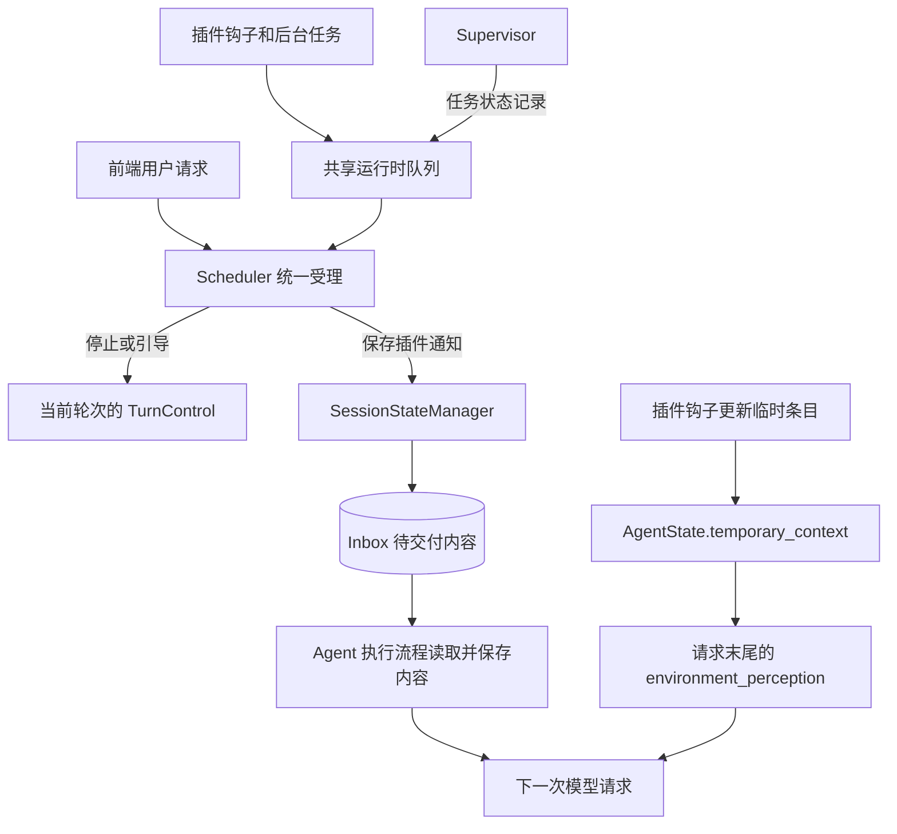
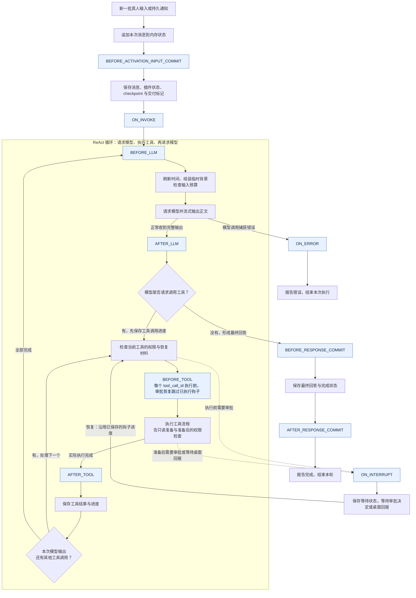

# Ayaya 插件开发指南

Ayaya 是运行在用户电脑上的桌面智能体应用。插件可以给它增加工具、连接外部程序、参与模型和工具的执行过程、启动后台任务，以及向 Agent 或界面发送消息。本文从插件作者的角度说明如何使用这些功能。

本文介绍框架提供的插件接口和使用方式。游戏连接及对应 MCP 程序是业务示例，需要插件作者实现或安装。

## 功能目录

| 想做什么 | 阅读章节 |
| --- | --- |
| 理解项目、词汇和调用关系 | [1 规约](#1-规约) |
| 创建、启用、配置插件，提供工具和 MCP | [2 配置、工具与MCP](#2-配置工具与mcp) |
| 在模型请求、工具执行等时机运行代码 | [3 插件钩子](#3-插件钩子) |
| 启动、查询、等待、停止后台任务 | [4 后台任务](#4-后台任务) |
| 给 Agent 发送环境变化等内容 | [5 消息投递](#5-消息投递) |
| 请求停止或引导当前轮次 | [6 控制信号](#6-控制信号) |
| 使用框架提供的前端展示 | [7 前端展示](#7-前端展示) |
| 每次请求模型前加入临时信息 | [8 临时消息](#8-临时消息) |
| 给原生 Python 预装插件能力 | [9 原生 Python REPL 能力](#9-原生-python-repl-能力) |
| 完成一个游戏观察插件 | [10 开发示例](#10-开发示例) |
| 查找接口、验证自己的插件 | [11 附录](#11-附录) |

## 1 规约

### 1.1 一段对话是怎样执行的

用户向某个会话发送消息。Scheduler 保存待处理输入，并安排该会话的 Agent 开始工作。Agent 调用模型，模型可以回答，也可以请求执行工具；工具结果交回模型后，模型可以继续请求工具，最后形成回答。

插件可以在这个过程中执行自己的代码。例如，每次调用模型前读取游戏状态，或者在一轮开始时提交一个后台分析任务。

### 1.2 本文统一使用的词

| 名称 | 本文含义 |
| --- | --- |
| Agent | 负责读取输入、请求模型、执行工具并形成回答的程序 |
| 模型，LLM | Agent 调用的大语言模型，接收消息并生成文字或工具调用请求 |
| 会话 | 用户持续与 Ayaya 交谈的一段对话，有自己的设置和历史 |
| 轮次 | Agent 从一批输入开始执行，直到正常完成、停止、被引导打断或失败结束 |
| 模型请求 | 一次向 LLM 提交输入并接收输出的过程 |
| 钩子 | 框架在约定时机调用插件代码 |
| 工具 | 模型可以选择调用的一个操作，具有名称、参数和返回结果 |
| MCP 服务 | 通过 MCP 协议提供工具的外部程序或 HTTP 服务 |
| 插件 | 实现一项功能所需代码和配置的集合 |
| Skill | 完成一件事的说明书，可附带材料 |
| 后台任务 | 提交后由应用管理执行和收尾的独立工作 |
| 任务终态 | 一次后台执行已经结束时的状态 |
| 静默后台任务 | 结束时不把结果交给 Agent 的后台任务；其状态仍可查询和显示 |
| 插件通知 | 插件主动发给 Agent、经 Inbox 交付并保留在会话中的内容，可以在任务仍运行时发送 |
| 临时背景条目 | 本轮供模型参考的一项标题、正文和图片，按来源名称保存，可更新和删除，审批恢复后继续使用 |
| 请求临时消息 | 每次模型请求前由临时背景条目组装的消息，只发送给本次模型请求 |
| 任务结果通知 | 后台任务结束后交给 Agent 的状态和结果 |
| 控制请求 | 请求 Scheduler 停止来源轮次，或保存引导正文后结束来源轮次 |
| 前端消息 | 发给界面的事件，由前端代码决定怎样显示 |
| 投递 | 插件请求已放入共享运行时队列，随后由 Scheduler 受理 |
| 受理 | 框架接受请求；内容请求受理成功时，内容已经保存 |
| 交付 | 内容被加入 Agent 的持久会话状态 |
| 自动执行资格 | 会话当前是否允许因为待处理通知而启动 Agent |
| 暂停自动执行 | 用户主动停止后，待处理通知不再自动激活Agent，而是保存至下一次真人输入成功受理后恢复处理 |
| 会话 worker | Scheduler 为一个会话运行的异步工作，按顺序检查输入并执行 Agent |
| 状态快照 | 一次查询或前端恢复时取得的当前状态记录 |
| checkpoint | 保存当前 Agent 状态的记录，用于后续加载和继续处理 |
| Inbox | 数据库中保存的待交付输入 |
| 共享运行时队列 | 应用内的一条内存队列，Scheduler 从中接收任务状态和插件请求 |

会话用 `session_id` 标识，轮次用 `run_id` 标识，每次后台执行用 `task_id` 标识。插件和任务的 `name` 是开发者定义的稳定名称，`title` 是用户可读的任务说明。

等待工具审批时仍属于同一轮。用户通过引导改变要求后，旧轮结束，后续执行处理引导内容。

### 1.3 主要对象分别做什么

| 对象 | 谁创建 | 负责什么 | 插件作者怎样接触它 |
| --- | --- | --- | --- |
| `BasePlugin` | 插件作者定义子类，框架创建实例 | 记录插件名称、配置和订阅的钩子 | 继承并实现 `hooks`、`execute()` |
| `PluginContext` | Agent 装配插件时创建 | 提供该插件独立的会话配置快照和通用数据库工厂 | 构造函数的关键字参数 `context` |
| `PluginManager` | Agent | 注册插件，按时机调用插件，记录普通插件异常 | 由框架使用 |
| `HookContext` | PluginManager | 提供当前钩子、会话状态和该次调用的数据 | `execute(context)` 的参数 |
| `Agent` / `ExecutionPipeline` | 框架 | 执行一轮中的模型、工具、审批和结果保存 | 插件通过钩子参与 |
| `AgentRuntimeScheduler`，下文简称 Scheduler | 应用 | 受理输入和控制请求，安排Agent执行 | 通过下述 `PluginRuntime` 提交请求 |
| `TaskSupervisor`，下文简称 Supervisor | 应用 | 运行后台任务，处理停止、异常、清理和结果保存 | 通过 `PluginRuntime` 的任务方法使用 |
| `BaseTask` | 插件作者定义子类，每次提交创建任务对象 | 实现这次工作的 `run()`，按需实现 `cleanup()` | 由插件钩子直接提交给 runtime |
| `SessionStateManager` | 框架 | 受理内容，读取 Inbox，保存会话状态和交付结果 | 由 Scheduler、Agent 和执行流程使用 |
| `PluginRuntime` | 框架注入，已实现 | 给插件提供后台任务、通知、控制和前端消息方法 | 从 `context.runtime` 或后台任务的 `run(runtime)` 取得 |

`PluginRuntime` 定义在 `app.agent.plugins.runtime`，是框架按插件和调用来源创建的类实例。它保存 `plugin_name`、`session_id`、`run_id`、可选的 `subagent_id` 和 `task_id`，内部使用应用共享的 Supervisor 和队列。公共任务父类 `BaseTask` 定义在 `app.agent.runtime.tasks.base`。

Supervisor 使用 `app.agent.runtime.tasks.runtime.TaskRuntime` 约定运行时共有的来源字段和任务编号绑定方法。插件任务实际收到 `PluginRuntime`；工具任务收到 `ToolRuntime`。本指南的通知和控制示例使用插件的运行时能力。

框架的运行管理代码集中在 `app/agent/runtime/`：Agent 工厂、会话 Scheduler、轮次控制和输入数据位于该目录，`tasks/` 保存 `BaseTask`、`TaskRuntime` 和 `TaskSupervisor`。`app/environment.py` 负责应用环境和存储路径。插件自己的业务代码继续放在插件目录。

仓库已有的 `RuntimeContext` 保存本轮来源、真人输入编号、控制信号等执行数据。临时背景条目保存在 `AgentState.temporary_context`，由 `context.agent_state` 的已有方法更新。`PluginRuntime` 提供任务、通知和控制方法。

### 1.4 请求和内容怎么流动



共享运行时队列只有一条。任务状态记录、控制请求和插件通知请求共用它。Inbox 保存需要交给 Agent 的持久输入；纯停止命令直接进入控制处理。临时背景由执行中的钩子更新当前 AgentState，在准备模型请求时组装，使用上图的临时条目路径。

任务结果还有一项保存顺序：Supervisor 先在同一个数据库事务中保存任务终态和唯一的 Inbox 结果通知，再发布任务状态记录。Scheduler 收到记录后更新界面、提醒检查 Inbox。插件主动通知则由 Scheduler 受理后保存。

需要显示在前端的事件沿用 `InteractionEvent → SSE → Electron → 渲染进程`。框架分配事件编号，前端按事件类型显示。

这里的前端是 Electron 桌面窗口：后端通过 SSE 连接发送事件，Electron 将事件交给窗口中的页面代码。内容交付采用同一数据库事务保存消息、checkpoint 和 Inbox 的已交付标记，这些记录一起成功或一起回滚。

### 1.5 插件从哪里取得调用对象

当前钩子通过 `HookContext` 取得以下内容：

| 字段 | 用法 |
| --- | --- |
| `context.hook` | 判断这次调用发生在哪个时机 |
| `context.agent_state` | 读取当前会话状态和消息，更新插件附加数据及临时背景条目 |
| `context.data` | 读取该钩子的数据，具体结构见第3章 |
| `context.metadata` | 读取或原地补充该次调用的附加信息 |
| `context.runtime` | 提交后台任务、查询记录、投递通知、控制及前端发布请求 |

应用已注入 `context.runtime: PluginRuntime`，每个插件取得自己的 Context，原状态、钩子数据和公共 metadata 继续共享；传入空字典时也沿用原对象。后台任务收到的 `runtime` 提供相同方法，并额外绑定自己的 `task_id`。框架自动绑定 `plugin_name`、`session_id`、来源 `run_id` 及子上下文 `subagent_id`。独立构造 Agent 或 PluginManager 的测试若使用这些能力，需要注入 `plugin_runtime_factory` 或 `runtime_factory`；未注入时 `context.runtime` 为 `None`。

`runtime.run_id` 一直表示创建该调用对象的来源轮次。后台任务跨轮次继续运行时，它发送的停止或引导仍指向原轮次，Scheduler 拒绝过期请求并记录原因。普通插件通知可以继续投递到所属会话。

### 1.6 公共方法

下表为 PluginRuntime 的真实方法。未知或超出当前插件、会话范围的查询和等待返回 None；超时返回当前记录，不停止任务。

| 调用 | 返回值 | 用途 |
| --- | --- | --- |
| `await runtime.submit_task(task, name=..., title=..., notify_agent=...)` | `str`，新任务的 `task_id` | 提交后台任务 |
| `await runtime.get_task(task_id)` | `TaskSnapshot` 或 `None` | 查询当前任务进展、结果或保存故障 |
| `await runtime.wait_task(task_id, timeout_ms=...)` | `TaskSnapshot` 或 `None` | 等到结果保存结束或本次等待超时，返回任务摘要 |
| `await runtime.stop_task(task_id)` | `None` | 投递停止后台任务的请求 |
| `await runtime.notify(name=..., text=...)` | `None` | 投递给 Agent 的插件通知请求 |
| `await runtime.stop_turn()` | `None` | 投递停止来源轮次的请求 |
| `await runtime.steer_turn(text)` | `None` | 投递引导请求，由 Scheduler 保存正文并请求结束来源轮次 |
| `await runtime.publish_event(name, payload)` | `None` | 投递前端消息发布请求 |

上述五个投递方法正常返回表示请求已入队。Scheduler 随后完成校验、保存或控制处理，拒绝及处理失败由框架统一记录。插件调用继续自己的工作，不等待受理结果或目标轮次结束。前端 HTTP 入口仍使用已有的 `CommandReceipt`，插件投递方法不返回该对象。

### 1.7 持续显示的前端提示

插件通过 `runtime.publish_event(InteractionEventKind.STATUS_NOTICE, payload)` 显示持续提示。它位于聊天记录上方的独立区域，适合展示连接中、正在执行等当前状态。

```python
from app.schemas.runtime_types import InteractionEventKind

await runtime.publish_event(InteractionEventKind.STATUS_NOTICE, {
    "id": "connection", "active": True, "text": "正在连接应用",
})
await runtime.publish_event(InteractionEventKind.STATUS_NOTICE, {
    "id": "connection", "active": True, "text": "已连接，正在执行",
})
await runtime.publish_event(InteractionEventKind.STATUS_NOTICE, {
    "id": "connection", "active": False,
})
```

`id` 为非空字符串，`active` 必须是布尔值；开启和更新还需提供非空 `text`。同一会话中，一个插件使用同一 id 会更新原提示，其他插件的同名提示分别显示。重复关闭已经移除的提示可以完成。框架从调用对象绑定插件、会话、来源轮次和任务编号，只提取规定的展示字段。

提示一直显示到显式关闭、切换会话或当前连接断开。插件负责在业务结束时关闭；后台任务可以跨轮次更新和关闭。刷新聊天历史保留当前提示，断线重连则从新事件开始显示。

持续提示只更新界面，不进入聊天历史、checkpoint、临时背景或模型输入，也不会唤醒 Agent。原有 `notice` 仍按短暂提示处理。方法返回表示已入队；非法载荷由现有发布请求受理入口拒绝。

## 2 配置、工具与MCP

插件页按配置 Schema 生成字段控件，复杂字段使用 JSON 编辑，保存前统一校验。插件自己的工具权限和 MCP 连接状态在同一卡片展示；连接参数由开发者定义。

插件有两个放置位置，按代码的维护和分发方式选择：

| 位置 | 用途 | 发现和加载方式 |
| --- | --- | --- |
| `app/agent/plugins/<插件名>/` | 随 Ayaya 一起维护和发布的插件，例如 `memory`、`computer_use` | 框架扫描直接子模块和包，按目录名登记延迟加载目标，使用 `app.agent.plugins.<插件名>` 导入 |
| 根目录 `plugins/<插件目录>/` | 独立安装、更新或分发的插件包，保存在框架实现目录之外 | 应用启动时加载包的 `__init__.py`，以插件类的 `name` 登记，支持包内相对导入 |

两处使用同一个 `BasePlugin` 接口，都按会话启停，遵循相同的配置、工具权限及生命周期流程；插件名称在全部目录中保持唯一。

设置页保存每个插件的 `enabled` 和 `config`，下一轮创建 Agent 时只装配明确开启的插件。所有插件默认关闭；缺少插件记录或未填写 `enabled` 时保持关闭，已有显式开关继续生效。

插件通过已有 `config_model` 声明业务参数及默认值，由设置准备流程校验；插件总开关使用会话中的 `enabled`。`ChatSettings` 和 DAO 负责通用结构与保存内容，读取配置时不自动插入插件记录。

Agent 通过普通构造函数统一传入 `PluginContext`，插件从中取得当前会话配置和 SQLite 工厂；启用记忆的直接 Agent 调用必须提供 `chat_settings`。插件构造时保存配置材料，具体查询或后台任务自行打开并关闭资源。

记忆插件的 `MemoryOperation` 固定本次模型、角色、环境和能力开关。后台任务携带该材料及历史截止位置，跨轮次执行时继续使用提交时的配置。`DiaryTask`、`LongTermMemoryTask` 均在 `run()` 内进入操作上下文；原 Agent 结束后，任务仍能独立完成。并行查询或提取等待全部分支结束后再传播错误或取消，随后关闭资源。语义记忆按本地向量目录排队，直到前一操作实际关闭后再打开客户端。

新激活先将消息追加到内存中的 `AgentState.messages`，再执行提交前钩子。插件直接从状态读取本次输入；记忆插件根据最新消息的类型累计真人计数。需要随输入持久化的插件状态写入 `AgentState.extra` 的自有命名空间，随后与输入和 Inbox 交付标记一次保存。记忆计数位于 `extra["memory"]["long_term_memory_turn_counter"]`，禁用整个插件时暂停累计；原轮次恢复和中途通知不重复触发新激活钩子。

### 2.1 集中存放一个插件的文件

项目自带插件以目录名作为发现时使用的插件名，目录名应与插件类的 `name` 一致，并可作为 Python 模块名。包的 `__init__.py` 导出插件类。例如：

```text
app/agent/plugins/
├── memory/
│   ├── __init__.py           导出 MemoryPlugin
│   ├── memory.py             记忆插件构造和钩子
│   ├── config.py             配置默认值、环境与路径解析
│   ├── operation.py          操作配置快照和资源上下文
│   ├── state.py              checkpoint 记忆命名空间
│   ├── manager.py            操作内的记忆业务协调
│   ├── memories/             日记、情景和语义记忆
│   ├── store/                协议历史查询和记忆持久访问
│   ├── tools/                长期记忆和日记查询工具
│   └── tasks/                记忆插件自己的后台任务
└── computer_use/
    ├── __init__.py           导出 ComputerUsePlugin
    ├── plugin.py            配置、REPL 声明和环境钩子
    ├── docs/api.md          Agent 通过 cua.help() 读取的完整说明
    └── repl/ayaya_computer_use/
        ├── api.py           模型直接使用的 cua 和窗口对象
        ├── accessibility.py 窗口控件树读取和语义动作
        ├── capture.py       后端钩子与 runner 共用的纯捕获代码
        ├── escape.py        独立消息线程区分物理 ESC 与模型注入的 Escape
        ├── native_input.py  保存输入过程的剪贴板和按键，异常或中断后释放
        ├── screen_helper.py 准确窗口、UIA 和输入的系统边界
        └── types.py         窗口观察、捕获区域和控件信息的数据结构
```

独立插件包则集中放在根目录 `plugins/`。下面以独立分发的游戏插件为例，将文件放在 `plugins/game-helper/`：

```text
plugins/
└── game-helper/
    ├── __init__.py           导出唯一插件类，作为包入口
    ├── game_helper.py        插件类、配置和钩子
    └── tools/
        ├── __init__.py
        └── game_help.py     这个插件提供的工具
```

游戏连接、后台任务等文件也放在同一目录，按规模增加 `connection.py`、`tasks/` 等文件或子目录。开发者可以将整个目录一起管理和分发。本指南使用框架提供的展示方式。

记忆插件的 `DiaryTask` 和 `LongTermMemoryTask` 位于该插件的 `tasks/memory_tasks.py`。`app/agent/runtime/tasks/` 保存框架通用的 `BaseTask` 和 `TaskRuntime`；两种位置的插件都将自己的具体任务放在各自插件目录中。

记忆插件在 `MemoryPlugin.tools` 中声明 `search_memory` 和 `search_diary`，实现分别位于 `memory/tools/search_memory.py` 与 `memory/tools/search_diary.py`。两个工具随记忆插件装配，权限在记忆插件卡片中管理；新出现的权限默认 `ask`。停用记忆插件后，两个查询工具也停止提供。模型看到的是框架生成的、包含插件归属的工具名称。

在 `plugins/game-helper/__init__.py` 导出唯一入口类：

```python
from .game_helper import GameHelperPlugin
```

`game_helper.py` 使用相对导入引用自己的工具：

```python
from .tools.game_help import game_help
```

`game-helper` 是磁盘上的目录名，`game_helper` 是本例的插件稳定名称。加载功能按 Python 包的方式加载这个目录，让目录内的相对导入生效；插件的配置和消息来源继续使用 `name="game_helper"`。独立插件包通过 `__init__.py` 导出唯一插件类，安装和更新后重启应用。

应用启动时扫描 `app/agent/plugins/` 和根目录 `plugins/`。独立包入口必须导出唯一插件类，目录内相对导入可用；安装、更新和移除后重启应用生效。

屏幕插件 `computer_use` 随项目提供。启用后，原生 Python REPL 预装 `cua`，Agent 可显式读取控件树、截图和操作桌面。`inject_screen_state` 默认关闭；开启后每次主模型请求前提供当前主屏画面，环境图保存在 `environment/`。窗口保持当前显隐。显式观察按普通 Python 工具图片保存与压缩，使用方式见[插件帮助](../app/agent/plugins/computer_use/docs/api.md)。

### 2.2 定义用户可以修改的参数

当前插件使用配置模型说明参数。下面的代码可定义字段、默认值、显示名和说明：

```python
from pydantic import BaseModel, Field

class GameHelperConfig(BaseModel):
    """保存游戏插件需要的连接地址和提示开关。"""

    endpoint: str = Field(
        default="tcp://127.0.0.1:9001",
        title="游戏状态连接地址",
        description="插件用这个地址接收游戏状态变化。",
    )
    show_progress: bool = Field(
        default=True,
        title="显示游戏状态提示",
        description="收到状态变化时，是否在界面显示简短提示。",
    )
```

设置页根据字段定义生成输入控件：布尔值显示开关，数字显示数字输入，字符串显示文本输入，固定选项显示选择框。默认值用于首次使用和新增缺失字段，用户已经保存的值优先。

前端按完整 Schema 校验控件及 JSON 内容，显示字段错误并阻止非法提交；后端配置模型继续校验自定义规则，错误回到对应字段。启用插件要求参数完整，禁用时允许暂缺必填项；已有字段的类型和约束仍需有效。没有默认值的必填字段不会被自动填入虚构值。

### 2.3 编写工具

本地工具可以沿用当前 `@tool`。`description` 是发给模型的说明；函数文档注释帮助维护代码。模型参数的说明写在 `Annotated` 中。

```python
from typing import Annotated
from app.agent.tools.core.decorator import tool

@tool(description="查询游戏帮助，返回指定主题的操作说明。")
async def game_help(topic: Annotated[str, "需要查询的游戏帮助主题。"] = "移动") -> str:
    """返回示例游戏的操作帮助。

    Args:
        topic (str): 开发者提供帮助内容的主题。

    Returns:
        str: 对应主题的说明，或可查询主题的提示。
    """
    help_text = {"移动": "使用移动工具前往目标位置。", "战斗": "先读取敌人状态，再选择行动。"}
    return help_text.get(topic, "支持的帮助主题：移动、战斗。")
```

装饰后的 `game_help` 是一个 `BaseTool` 子类，框架创建实例后交给执行流程。需要自己处理复杂参数和结果时，可以继承 `BaseTool` 并实现 `execute(args, context) -> ToolResult`。

`@tool` 负责把函数转换成工具类。插件附带的工具放在自己的 `plugins/game-helper/tools/` 中，由插件的 `tools` 成员提供，随插件启用状态创建。框架为模型名称和审批身份添加插件归属，插件仍使用原始工具名；权限不进入独立工具配置。

### 2.4 在插件上列出工具和 MCP 服务

以下声明随当前会话的插件开关装配。插件 MCP 连接类型只包含参数，声明即随插件启用，无独立 `enabled` 字段。

```python
from app.agent.plugins.base import BasePlugin, HookContext, PluginContext, PluginHook
from app.schemas.mcp import StdioMCPConnectionConfig
from .tools.game_help import game_help

class GameHelperPlugin(BasePlugin):
    """为游戏提供帮助工具、MCP 配置和执行期间的观察代码。"""

    name = "game_helper"
    description = "提供游戏工具并接收游戏状态。"
    config_model = GameHelperConfig
    tools = (game_help,)
    mcp_servers = (
        StdioMCPConnectionConfig(
            id="game_server",
            name="游戏操作服务",
            command="game-mcp-server",
            args=[],
        ),
    )

    def __init__(self, *, context: PluginContext, **config) -> None:
        """校验并保存用户设置。

        Args:
            context (PluginContext): 当前 Agent 提供的会话配置快照和数据库工厂。
            **config (Any): 设置页保存的插件参数。
        """
        self.config = GameHelperConfig(**config)

    @property
    def hooks(self) -> list[PluginHook]:
        """列出插件希望参与的执行时机。

        Returns:
            list[PluginHook]: 本例先提供工具和连接配置，暂未订阅钩子。
        """
        return []

    async def execute(self, context: HookContext) -> None:
        """保留钩子入口，后续章节会添加具体行为。

        Args:
            context (HookContext): 框架提供的该次调用数据。
        """
        return
```

这三段代码分别展示文件内容：`GameHelperConfig` 和 `GameHelperPlugin` 放在 `plugins/game-helper/game_helper.py`，工具放在 `plugins/game-helper/tools/game_help.py`。

这些公共成员统一由父类 [BasePlugin](../app/agent/plugins/base.py) 声明，子类填写自己的具体值。公共成员如下：

| 插件类成员 | 父类中的定义 | 插件作者填写什么 |
| --- | --- | --- |
| `name` | 类型声明，具体名称由子类提供 | 稳定名称，供配置、目录和消息来源使用 |
| `description` | 默认空字符串 | 设置页显示的用途说明 |
| `config_model` | 默认 `None` | 插件自己的参数模型 |
| `tools` | 默认空元组 `()` | 当前插件提供的工具类 |
| `mcp_servers` | 默认空元组 `()` | 当前插件提供的 MCP 连接参数 |
| `resolve_mcp_servers(config)` | 类方法，默认返回 `mcp_servers` | 按已校验插件参数生成连接声明 |
| `hooks` / `execute()` | 抽象属性和抽象方法 | 订阅的钩子列表及对应代码 |
| `priority` | 默认 `100` | 需要调整同一钩子内顺序时覆盖 |

父类还提供 `version="1.0.0"`。子类里写 `description=...`、`tools=(game_help,)` 表示填写或覆盖这些公共成员。`hooks` 当前带有 `@property`，框架读取 `plugin.hooks` 取得列表，再在对应时机调用 `execute(context)`。

`mcp_servers` 列出插件自己的服务连接参数。各会话分别连接，服务可以同名。需要用户修改的连接参数放入 `config_model`，覆盖 `resolve_mcp_servers(config)` 生成最终连接声明；该类方法只计算参数，不建立连接，也不创建插件实例。`game-mcp-server` 是示例程序名，实际插件需说明如何安装对应服务。

例如，将下面的类方法放在上面的插件中，可以把用户保存的游戏连接地址传给 MCP 进程：

```python
@classmethod
def resolve_mcp_servers(cls, config: dict) -> tuple[StdioMCPConnectionConfig, ...]:
    """根据用户填写的游戏地址生成 MCP 进程参数。

    Args:
        config (dict): 已校验的插件参数，包含游戏连接地址。

    Returns:
        tuple[StdioMCPConnectionConfig, ...]: 当前会话使用的游戏服务。
    """
    return (StdioMCPConnectionConfig(
        id="game_server", name="游戏操作服务", command="game-mcp-server",
        args=["--game-endpoint", config["endpoint"]],
    ),)
```

### 2.5 用户怎样启用和配置

用户在当前会话按以下顺序操作：

1. 在插件页找到“game_helper”，查看用途和参数说明。
2. 启用插件，填写游戏连接地址和提示开关，保存当前会话设置。
3. 在该插件卡片中设置本地工具的 `allow`、`ask` 或 `deny`。
4. 下一次创建 Agent 时，插件声明的 MCP 随插件连接，在卡片中查看连接状态和远端工具权限。连接参数由开发者定义，需要修改的值通过插件参数提供。

插件参数保存在现有会话 YAML 中，形状如下：

```yaml
agent_plugins:
  game_helper:
    enabled: true
    config:
      endpoint: tcp://127.0.0.1:9001
      show_progress: true
    tool_permissions:
      local:game_help: ask
      mcp:game_server:read_status: ask
    mcp_identities: {}
```

插件参数和两类工具权限保存在自己的记录中，`mcp_identities` 由框架在连接成功后维护。独立工具和用户手动添加的 MCP 仍使用各自原位置，原工具页和 MCP 页只管理这些独立能力。

| 设置 | 决定什么 |
| --- | --- |
| 插件启用 | 当前会话是否启用该插件 |
| 插件参数 | 插件开发者定义的插件参数 |
| 本地工具权限 | 模型调用该本地工具时允许、询问还是拒绝 |
| MCP 连接参数 | 由插件声明或插件参数生成，无独立启停开关 |
| MCP 工具权限 | 模型调用服务内某个工具时允许、询问还是拒绝 |

框架保存用户修改。停用插件时关闭本会话对应连接，跨轮次保留仍启用的连接；移除插件并重启后，完整发现成功才清理其在全部会话中的配置和权限。导入失败时保留设置并报告错误。

### 2.6 验证插件发现与运行装配

已有 `PluginRegistry.list_plugins()`、`PluginRegistry.get(name)` 和 `GET /plugins` 可以查询框架已经发现的插件及其配置元数据。已有 `agent.register_plugin(plugin)` 可在开发或测试中向一个 Agent 同步登记实例及其业务钩子；`agent.unregister_plugin(name)` 同步移除登记，返回是否找到并移除了插件。

内置目录仍扫描直接子模块和普通包，跳过框架辅助模块。独立目录由启动流程扫描 `plugins/<包>/__init__.py`，入口导出唯一插件类后登记其稳定名称。重复名称和无效声明报告错误，不覆盖已有插件。也可以在开发和测试中使用 `PluginRegistry.register_lazy(name, "模块路径:类名")`。

生产构造入口通过 `ChatSettingsService.prepare()` 取得会话设置和各插件准备结果。每个插件在同次准备中校验一次参数，再将独立副本交给 `resolve_mcp_servers(config)` 生成 MCP 声明；Agent 直接复用这些结果，初始化时创建启用的插件、注册钩子和本地工具，并连接已准备的插件 MCP。读取配置页继续保留待修正参数，不解析 MCP。连接管理器在异步等待后仍会根据最新会话参数复核连接配置。会话开关与参数用于下一次装配，执行和审批恢复仍复查当前权限。`GET /plugins/mcp-status/{session_id}` 只读查询连接状态，不触发连接，不返回参数或凭据。

Agent 对所有插件统一调用 `plugin_class(context=plugin_context, **plugin_params)`。覆盖构造函数时，必须显式接收关键字参数 `context: PluginContext`；沿用基类构造函数的插件也能接受上下文。`plugin_params` 是用户保存的业务配置，与宿主运行依赖分开传递。

`PluginContext` 定义在 `app.agent.plugins.base`，只有 `chat_settings` 和 `sqlite_factory` 两个字段。每个插件得到本次 Agent 配置的独立深拷贝，插件私有修改彼此隔离；配置更新由新建 Agent 使用。直接创建独立 Agent 时可以省略完整会话配置，此时 `chat_settings` 为 `None`，需要它的插件自行校验。`sqlite_factory` 提供宿主指定的数据库位置和连接配置，实际连接由插件操作或后台任务通过上下文管理器打开、关闭。框架按统一契约构造插件，具体业务对象由插件内部装配。

## 3 插件钩子

### 3.1 一个最小插件

下面的插件在每次请求模型前记录当前会话编号：

```python
import logging
from app.agent.plugins.base import BasePlugin, HookContext, PluginHook

logger = logging.getLogger(__name__)

class RequestLogPlugin(BasePlugin):
    """记录每次模型请求所属的会话。"""

    name = "request_log"
    description = "帮助开发者观察模型请求时机。"

    @property
    def hooks(self) -> list[PluginHook]:
        """订阅模型请求前的时机。

        Returns:
            list[PluginHook]: 本插件订阅的钩子。
        """
        return [PluginHook.BEFORE_LLM]

    async def execute(self, context: HookContext) -> None:
        """在模型请求前记录会话编号。

        Args:
            context (HookContext): 当前钩子和会话状态。
        """
        logger.info("即将请求模型，会话：%s", context.agent_state.session_id)
```

`PluginManager` 按 `hooks` 找到插件并调用 `execute()`。同一时机有多个插件时，`priority` 数字较小的先执行，默认值为 100。

### 3.2 选择合适的钩子

| `PluginHook` | 何时调用 | 当前 `context.data` | 适合做什么 |
| --- | --- | --- | --- |
| `BEFORE_ACTIVATION_INPUT_COMMIT` | 新一批输入加入会话前 | 与 `ON_INVOKE` 共用的字典，起初为空 | 从之前的历史准备待处理资料 |
| `ON_INVOKE` | 同批输入及交付状态保存成功，启动本轮循环时 | 上一行准备的字典，并加入 `runtime_context` | 启动已准备的后台工作，根据本轮输入检索资料或提交任务 |
| `BEFORE_LLM` | 每次模型请求前 | 当前为空 | 通过 `agent_state.set_temporary_context()` 更新最新背景，或检查外部状态 |
| `AFTER_LLM` | 收到本次模型完整输出后 | `content`、`tool_calls` | 观察本次输出和工具选择 |
| `BEFORE_TOOL` | 每个具体工具调用首次进入执行前，按 `tool_call_id` 记录 | `tool_call` 字典 | 记录调用或做插件自己的准备 |
| `AFTER_TOOL` | 工具实际完成后 | `tool_call`、`result` | 读取 `ToolResult` 并更新插件信息 |
| `BEFORE_RESPONSE_COMMIT` | 保存最终回答前 | 本次响应前后共用的字典 | 准备最终回答相关资料 |
| `AFTER_RESPONSE_COMMIT` | 最终回答保存成功后 | 上一行的字典 | 执行成功保存后的处理 |
| `ON_INTERRUPT` | 工具暂停、准备保存并报告审批或桌面回报等待信息时 | `interrupt` | 观察工具暂停的原因和请求 |
| `ON_ERROR` | 当前模型调用捕获错误时 | `error` | 记录该次错误 |

下图展示当前正常执行主线，以及工具暂停和模型调用错误两个分支。蓝色节点表示插件钩子；中间的 ReAct 循环会根据模型输出反复请求模型、执行工具。



- 新输入开始执行时，先将本次消息追加到内存状态，再触发 `BEFORE_ACTIVATION_INPUT_COMMIT`；保存输入后触发 `ON_INVOKE`。审批恢复和本轮中途交付通知时继续原循环。
- `BEFORE_ACTIVATION_INPUT_COMMIT` 能读取包含本轮输入的内存状态，此时数据库仍是此前已提交的历史。输入和 checkpoint 保存成功后，`ON_INVOKE` 取得已提交状态及本轮真人输入编号。需要限定旧历史范围的插件可在前置钩子读取持久历史截止位置。
- 两个钩子的 `context.data` 是同一个字典。插件可在提交前按自己的名称保存准备数据，`ON_INVOKE` 再读取；框架在执行 `ON_INVOKE` 前加入 `runtime_context`。输入保存失败时，执行在 `ON_INVOKE` 之前结束。
- 一次模型输出可以包含多个工具调用，框架逐个处理。审批恢复回到原工具，已经触发过的 `BEFORE_TOOL` 会按保存的进度跳过；随后继续剩余工具和模型循环。
- `BEFORE_TOOL` 按具体 `tool_call_id` 计算，同一工具名的两次调用分别处理。执行前审批尚未通过时该钩子尚未触发；直接拒绝的调用可以一次也不触发。只读准备后才需要审批的调用，钩子在准备前已触发，恢复后沿用记录。
- `ON_INTERRUPT` 对应工具等待审批或桌面回报的暂停。停止、引导使用各自的结束处理；工具执行错误通常包装成工具结果，交给后续模型请求读取。

`BEFORE_LLM` 会随模型请求重复触发。一轮可以调用模型多次。响应提交钩子只在执行到对应保存步骤时运行；Supervisor 持有后台任务，任务完成或收到停止请求后由其统一清理。

### 3.3 一个插件订阅多个钩子时怎样分发

`hooks` 列出希望被调用的时机，每次调用由 `context.hook` 标明当前时机。`execute()` 中用 `if/elif` 选择对应逻辑。逻辑较长时，拆成插件自己的方法。

下面的类沿用 3.1 节的导入和 `logger`，分别处理一轮开始和模型请求前两个时机：

```python
class HookExamplePlugin(BasePlugin):
    """在不同钩子中执行各自的记录逻辑。"""

    name = "hook_example"

    @property
    def hooks(self) -> list[PluginHook]:
        """订阅一轮开始和每次模型请求前的时机。

        Returns:
            list[PluginHook]: 当前插件希望接收的钩子。
        """
        return [PluginHook.ON_INVOKE, PluginHook.BEFORE_LLM]

    async def execute(self, context: HookContext) -> None:
        """根据这次调用的时机执行对应逻辑。

        Args:
            context (HookContext): 当前钩子和会话状态。
        """
        if context.hook == PluginHook.ON_INVOKE:
            await self._on_turn_started(context)
        elif context.hook == PluginHook.BEFORE_LLM:
            await self._before_model_request(context)

    async def _on_turn_started(self, context: HookContext) -> None:
        """记录会话开始处理本轮输入。

        Args:
            context (HookContext): 本轮开始时的调用数据。
        """
        logger.info("开始处理输入，会话：%s", context.agent_state.session_id)

    async def _before_model_request(self, context: HookContext) -> None:
        """记录本轮中的一次模型请求。

        Args:
            context (HookContext): 本次模型请求前的调用数据。
        """
        logger.info("准备请求模型，会话：%s", context.agent_state.session_id)
```

一轮可能多次调用 `_before_model_request()`。`_on_turn_started()` 在新输入开始执行时调用，适合启动本轮需要的工作。

### 3.4 读取和保存插件自己的数据

`context.agent_state.messages` 提供当前消息的只读序列。消息对象有明确类型，例如 `HumanMessage`、`TaskResultMessage`。

少量需要随会话保留的插件数据可放在 `agent_state.extra`，使用插件名作为键：

```python
plugin_data = context.agent_state.extra.setdefault("request_log", {})
plugin_data["model_request_count"] = plugin_data.get("model_request_count", 0) + 1
```

这段修改由执行流程后续保存 checkpoint。`context.data` 和 `metadata` 用于该次调用；输入提交前后共用的字典适合传递“刚准备好的任务资料”。对 `AFTER_LLM` 等观察数据的修改，是否影响执行由具体调用点决定；当前改变字典中的 `content` 不会直接改写模型输出变量。

`HookContext` 固定各字段所指的对象，状态和字典通过原地操作修改。提交后台任务时，由插件把这次工作需要的文本、历史截止位置等资料传给任务；框架直接执行传入的任务对象。独立任务需要持续使用的资源由任务或应用对象持有，消息交付通过第5章的方法完成。

### 3.5 资源管理和普通异常

插件登记、注销只更新名称索引和业务钩子列表。同名登记会替换旧实例；Agent 关闭时清空插件索引。插件实例随 Agent 装配创建，实例成员适合保存本次执行使用的参数和数据。

一次工具或钩子调用使用的资源，在调用内部通过 `with`、`async with` 或 `try/finally` 管理。跨轮运行的后台工作交给 Supervisor，资源由具体任务持有，在 `run()` 内或 `cleanup()` 中释放。应用共享连接由已有的共享模块管理，插件声明的 MCP 连接沿用 MCP 连接管理器。保存配置由设置功能完成。

`execute()` 抛出的普通异常由 PluginManager 记录，随后继续调用其他插件。异常发生前已做的原地修改会保留。希望请求停止或引导时，调用第6章的方法。

## 4 后台任务

插件任务和终端任务都经 Supervisor 的同一个 `submit()` 管理。终端工具通过 `ToolContext.runtime` 中的 `ToolRuntime` 提交具体任务；`TerminalService` 只创建系统终端，`TerminalTask` 负责本次进程、交互、输出和清理，Supervisor 统一处理生命周期。本章使用插件的 `PluginRuntime` 入口。

### 4.1 定义后台任务

任务继承 `app.agent.runtime.tasks.base.BaseTask`，实现 `async run(runtime) -> str | None`。返回字符串用于记录最终结果，返回 `None` 表示本次工作没有结果正文。父类提供默认空的 `async cleanup() -> None`，需要释放资源时覆盖；生命周期流程仍由 Supervisor 负责。

具体任务的 `run()` 就是受管工作的执行入口，在其中直接 `await` 业务操作。插件钩子构造具体任务后交给 runtime 提交；Supervisor 创建并持有执行协程，保存结果及配置要求的通知，交付结果后调用资源清理。例如，记忆插件在 `execute()` 中直接提交 `DiaryTask` 和 `LongTermMemoryTask`，两个任务的 `run()` 分别等待日记整理和长期记忆提取。

下面的任务接收一份字符串，返回输入规模：

```python
from app.agent.runtime.tasks.base import BaseTask
from app.agent.plugins.runtime import PluginRuntime

class TextStatsTask(BaseTask):
    """统计提交时传入的输入文本。"""

    def __init__(self, text: str) -> None:
        """保存这次任务需要的独立文本。

        Args:
            text (str): 提交任务时传入的输入内容。
        """
        self.text = text

    async def run(self, runtime: "PluginRuntime") -> str:
        """计算并返回任务结果。

        Args:
            runtime (PluginRuntime): 框架绑定来源和任务编号后的调用对象。

        Returns:
            str: 输入的字符数和行数。
        """
        return f"输入共 {len(self.text)} 个字符、{len(self.text.splitlines())} 行。"
```

`PluginRuntime` 是 `app.agent.plugins.runtime` 中的真实类型，字符串注解方便单独阅读任务定义。真实业务可以在 `run()` 中等待网络请求、处理文件或执行自己的异步流程。

Supervisor 调用 `run()`，结束时固定业务结果，由 DAO 同事务保存终态和通知，随后完成结果等待并调用 `cleanup()`。业务异常保存为失败；资源关闭错误记日志，已经保存的业务结果保持原结果。SQLite 占用错误首次后最多重试三次，总预算为 5 秒；其他存储错误直接上报。保存失败时摘要的 `phase` 和 `status` 为 `save_failed`，`save_error` 提供原因，结果观察者结束等待，具体资源继续关闭。同步线程仍在执行时的停止情况见 4.6 节。

### 4.2 在一轮开始时提交任务

本例只分析新收到的真人输入。`ON_INVOKE` 提供的现有 `RuntimeContext.latest_human_message_id` 用于找到这条输入，纯通知启动的执行会跳过分析，避免任务结果再次触发同类任务。

以下片段放在插件的 `execute()` 中：

```python
from app.agent.state.messages import HumanMessage

if context.hook == PluginHook.ON_INVOKE:
    current_input = context.data["runtime_context"].latest_human_message_id
    human = next(
        (message for message in context.agent_state.messages
         if isinstance(message, HumanMessage)
         and message.message_id == current_input),
        None,
    )
    if human is not None:
        task_id = await context.runtime.submit_task(
            TextStatsTask(human.text),
            name="input_stats",
            title="统计本轮输入规模",
            notify_agent=True,
        )
```

| 参数 | 怎么填写 |
| --- | --- |
| `task` | 这次运行的任务对象，已经保存所需输入资料 |
| `name` | 开发者定义的稳定任务名，可复用为插件内常量 |
| `title` | 这次工作给用户看的说明 |
| `notify_agent` | 是否在任务终态保存时生成结果通知 |

框架从 `context.runtime` 绑定插件、会话和来源轮次。返回 `task_id` 表示任务提交成功。提交失败抛出异常，由调用处或现有钩子异常处理记录；原任务若已返回编号，后续查询和等待始终使用这个编号。

### 4.3 后台任务的结束方式

后台任务跨回答轮次独立运行，直到任务自行完成或收到显式停止请求。主 Agent 和保留型子 Agent 的正常完成、停止、引导、失败及审批等待均保留正在运行的后台任务；一次性子 Agent 工作结束、子身份被销毁或父会话配置删除时，框架停止当时已登记的所属任务。关闭身份后迟到登记的普通任务仍可完成；应用退出封闭 Supervisor 后拒绝新的任务登记。

`runtime.run_id` 记录任务的来源轮次，并用于校验停止或引导该轮次的控制请求；轮次结束后，后台任务仍可继续运行。任务提交参数见第 4.2 节。

任务通过 `cleanup()` 释放自己持有的资源，Supervisor 负责执行、保存并交付结果，随后调用一次清理。具体任务在自己的清理方法内限制总预算和尝试次数，首次后最多重试三次。输出落盘和退出码属于 `run()` 的业务工作。`notify_agent` 单独控制终态是否写入结果通知，静默任务同样由 Supervisor 持有和清理。

### 4.4 查询、等待和停止

```python
from app.schemas.runtime_types import TaskStatus

record = await runtime.get_task(task_id)
record = await runtime.wait_task(task_id, timeout_ms=1000)

if record.status == TaskStatus.RUNNING:
    await runtime.stop_task(task_id)
else:
    result_text = record.result
```

`TaskSnapshot` 从 `app.schemas.task_types` 导入，包含 `name`、`title`、`result`、`error`、来源、通知配置，以及 `phase` 和 `save_error`。持久记录仍为 `TaskRecord`。非终端任务的命令、PID 和输出路径为空。

上例使用本插件刚提交得到的编号。`PluginRuntime.get_task()` 返回当前任务摘要；工具的 `ToolRuntime.get_task()` 和框架的 `Supervisor.get_task()` 返回尚未释放的具体任务对象。工具通过 `get_task_snapshot()` 查询摘要。插件通过摘要读取状态和结果。

- `get_task()` 返回当时的任务记录，只查询同一会话、同一子上下文内由本插件创建的任务；未知或超出该范围的任务返回 `None`。
- `wait_task()` 未找到可访问记录时返回 None；否则等待终态或本次预算结束，超时返回仍在运行的记录，任务继续运行。
- 取消等待只结束这次等待，后台任务继续执行；任务失败通过记录的 `status` 和 `error` 表达。
- `stop_task()` 投递停止请求后返回，Scheduler 随后受理并交给 Supervisor 执行停止和清理。
- 需要确认已经结束时，再用同一 `task_id` 查询或有限等待。

钩子本身会被 Agent 等待。希望后台工作与回答同时进行时，提交后让钩子返回；等待适合明确需要短暂观察结果的地方。

### 4.5 记录结果与通知 Agent

`notify_agent=True` 时，Supervisor 保存终态和唯一的 Inbox 结果通知。Agent 之后收到 `TaskResultMessage`，包含任务标题、状态及结果正文；业务失败时附上错误摘要。`run()` 返回的字符串先存入 `TaskRecord.result`，再随 Inbox 通知转换成任务消息。相邻任务通知可能合并，组内保留各任务的编号、状态和结果。普通任务登记和保存通知只记录固定来源，接收身份已经关闭时仍可完成；消费者按当前会话政策决定是否处理通知。

因此，`run()` 应返回需要记录、并按配置告知 Agent 的业务结果；运行进度和调试信息使用日志。`cleanup()` 返回 `None`，只负责释放资源。当前 OpenAI 模型转换把任务消息作为 `role="user"`、`name="runtime_task_result"` 发送，正文带任务结束状态和标题；整条任务记录及存储 JSON 留在持久化层。

`notify_agent=False` 时，任务仍记录状态和结果，界面可以读取；终态不会作为结果通知交给 Agent。`run()` 返回 `None` 与是否通知分别处理。

当前实现遵守以下时机：运行中有合适位置就交付；正常完成后空闲且仍有自动执行资格时，可以开始新轮处理；用户主动停止后等待下一次真人输入。第5章提供完整表格。

### 4.6 停止、线程和资源清理

异步任务响应停止后，由 Supervisor 调用其清理实现。文件、网络连接和进程等资源按各自功能释放。独立任务所需的资料和资源由任务或应用对象持有，任务可以比创建它的插件实例活得更久。

异步业务可以响应取消并完成结果保存；同步线程在取消外层等待后仍可能继续运行。当前记忆模块在 Mem0、Chroma 等实际同步线程调用处使用 `complete_owned_work()`，等待线程操作完成后再传播取消，包括关闭期间的重复取消；具体任务的 `run()` 直接等待业务方法。业务执行或结果保存尚未结束时计入活动任务，结果已保存或保存失败后的资源关闭由退出流程继续等待。应用退出时等待已登记任务和保存结束，不自动强制终止；用户在等待界面主动强制退出时才结束后端进程树，该操作可能打断尚未确认的保存。应用进程被强制结束时，本轮提取可能不完整，重启后保留已保存结果并将旧 running 标记为 orphaned。

## 5 消息投递

持久插件通知使用 `PluginNotificationMessage(RuntimeInputMessage)`，类型名称为 `plugin_notification`。消息类型、Inbox 类别、模型转换和公共提交入口均已接入。已有 `environment_perception` 用于第8章的请求临时消息。

### 5.1 在任务仍运行时报告变化

例如游戏监视任务检测到进入战斗，调用以下接口：

```python
await runtime.notify(
    name="battle_started",
    text="玩家进入战斗，发现两名敌人。",
)
```

`name` 表示插件自己的通知名称，重复使用的名称在插件内定义常量。`text` 是交给模型读取的正文。框架从 `runtime` 补充插件来源和会话，将请求放入共享运行时队列后调用即返回 `None`。Scheduler 随后经 Manager 保存 Inbox，完成持久受理，再安排交付。保存失败由框架统一处理和记录。

钩子中使用 `context.runtime.notify(...)`，后台任务中使用 `run(runtime)` 收到的对象。发通知后，调用者可以继续自己的工作。

### 5.2 通知保存成什么消息

`PluginNotificationMessage` 表达需要保留在会话中的插件内容，包含插件来源、通知名称和正文。当前发送给模型的正文例如：

```text
[插件通知：game_helper/battle_started]
玩家进入战斗，发现两名敌人。
```

消息交付时加入 `AgentState.messages`，与 checkpoint、Inbox 的已交付标记一起保存。它参与后续模型输入、历史和记忆处理，普通插件通知不增加真人消息计数。

任务最终结果通过第4章的 `notify_agent` 生成已有的 `TaskResultMessage`。持续变化的游戏状态通过第8章临时背景条目提供，框架每次请求时组装 `EnvironmentPerceptionMessage`；该派生消息只存在于模型请求中。

OpenAI 模型转换使用 `role="user"`、`name="runtime_plugin_notification"`，正文采用上面的插件来源和通知名称格式。

### 5.3 什么时候会处理通知

| 会话状态 | 插件通知和任务结果的处理方式 |
| --- | --- |
| 正在请求模型或执行工具 | 先保存，等工具调用与对应结果已成对记录、下一次模型请求前交付 |
| 正常回答结束，保留自动执行资格 | 可以开始新轮处理 |
| 用户刚主动停止 | 继续保存，等待下一次真人输入成功受理后恢复处理 |
| 等待人工审批 | 保留通知和审批状态，恢复到允许交付的位置后处理 |
| 应用刚启动，只有之前积压的通知 | 保存通知，等待真人输入重新激活会话 |
| 应用正在退出 | 由框架按关闭顺序处理，拒绝及处理失败统一记录 |

用户停止后的暂停同时作用于唤醒入口和已经存在的 worker。开发者只需发送通知，框架负责判断当前是否执行。

## 6 控制信号

前端和插件入口共用目标轮次核验及最终打断动作。

### 6.1 请求停止

```python
await runtime.stop_turn()
```

请求入队后调用返回，Scheduler 随后检查 `runtime.run_id` 指向的轮次是否仍在运行。请求受理后，模型等待及工具收尾按现有打断流程处理。目标过期或已经进入最终提交时，Scheduler 拒绝请求并记录原因。

调用完成后，后台任务或钩子继续执行下一行。观察任务希望同时结束自己的工作时正常 `return`。

### 6.2 提交引导

```python
await runtime.steer_turn("优先处理刚出现的敌人，稍后继续原目标。")
```

调用先投递引导请求。Scheduler 受理时先将带插件来源的引导正文保存为第5章的持久插件输入，再请求结束来源轮次。后续执行读取已保存的 `PluginNotificationMessage`。消息的通知名称表达引导用途；实现集中使用 `PluginRequestKind.STEER_TURN.value`，即 `steer_turn`。引导正文通过 Inbox 交付，临时背景继续按第8章处理。

引导请求同样绑定来源轮次。旧观察任务的迟到请求得到明确拒绝，新的轮次按自己的输入继续执行。

### 6.3 与用户操作同时发生时

前端请求直接进入 Scheduler，插件请求通过共享运行时队列进入同一处理逻辑。相同会话按锁依次受理，没有固定的前端或插件优先级。

同一轮次的 `TurnControl` 保留首个停止或引导原因。引导正文另行保存，因此后来的引导正文可能已经受理，打断原因仍保留先前值。插件投递方法返回只表示请求已入队。

用户主动停止还有暂停自动执行的含义，直到下一次真人输入成功受理才恢复。插件停止只结束来源轮次，保留会话已有的自动执行资格；之后的任务结果或插件通知仍可按第5章的规则启动新轮次。插件内容请求本身不恢复用户暂停的资格。

## 7 前端展示

插件通过框架支持的事件向已有界面展示信息，前端显示代码由框架统一维护。

### 7.1 使用框架提供的展示方式

插件使用框架集中定义的消息类型和载荷，界面沿用对应的展示方式。例如，Supervisor 发布任务状态后，现有界面更新任务数量、状态和终态提示。插件作者通过第4章提交任务即可参与这一流程。

前端发布使用 `await runtime.publish_event(name="notice", payload={"text": "正在观察游戏状态"})`。框架补充会话、插件来源、事件编号及任务关联信息，接入已有 `InteractionEvent` 输出。提示带插件来源，在聊天区域短暂显示，区别于 Agent 回复和提示栏；不进入持久历史或模型输入。

调用返回表示发布请求已入队，Scheduler 随后接入前端事件发布流程。

### 7.2 展示功能的当前范围

前端显示代码由框架统一维护。插件通过公共发布入口发送框架支持的事件，由现有页面处理和展示。

### 7.3 现有消息能显示什么

| 现有事件 | 当前界面效果 |
| --- | --- |
| `session_snapshot` | 恢复会话历史、阶段、排队输入、任务和审批状态 |
| `human_message` | 显示真人文本和图片 |
| `queued_message` / `queued_cancelled` | 添加或移除排队输入 |
| `task_status` | 更新任务状态、数量和终态提示 |
| `notice`，载荷含 `text` | 在聊天区域显示带插件来源的短暂提示 |
| `run_started` | 开始回答状态 |
| `text_chunk` | 更新聊天正文和桌面气泡 |
| `tool_call` | 显示工具调用状态 |
| `tool_completed` | 工具结果保存后收尾调用提示，并按该结果刷新历史 |
| `interrupt` / `authorization_resolved` | 显示或关闭审批交互 |
| `run_completed` | 结束回答状态并刷新历史 |
| `error` | 显示运行错误及相应重试入口 |

任务、回答和审批等事件由框架在对应流程中发布；插件通过公共发布入口使用当前支持的 `notice` 和 `text` 载荷。其他自定义名称目前不会被受理。

## 8 临时消息

`TemporaryContextItem` 保存临时背景的标题、正文和图片。插件在钩子中直接更新 `context.agent_state`，框架每次准备模型请求时组装环境消息。

### 8.1 三种内容分别放在哪里

| 内容 | 保存位置和使用方式 | 是否进入原始对话历史 |
| --- | --- | --- |
| 临时背景条目 `TemporaryContextItem` | 放在 `AgentState.temporary_context`，随后续 checkpoint 保存，审批恢复后继续使用 | 作为单独的状态数据保存 |
| 请求临时消息 `EnvironmentPerceptionMessage` | 每次请求从当前条目组装，追加在请求末尾 | 不进入会话消息列表和原始对话历史 |
| 持久插件通知，`PluginNotificationMessage` | 第5章通过共享队列受理、保存 Inbox，再加入会话消息 | 进入历史，供之后的执行使用 |

例如，“当前位置和生命值”适合临时背景；“刚进入战斗”这个需要留在会话中的事件适合插件通知。

### 8.2 每次模型请求前更新状态

在插件的 `hooks` 中订阅 `PluginHook.BEFORE_LLM`，在 `execute()` 中使用已有接口：

```python
from app.agent.state import TemporaryContextItem

GAME_STATUS_CONTEXT_KEY = "game_helper.status"

if context.hook == PluginHook.BEFORE_LLM:
    status_text = await game_client.read_status()
    context.agent_state.set_temporary_context(
        GAME_STATUS_CONTEXT_KEY,
        TemporaryContextItem(title="当前游戏状态", text=status_text),
    )
```

`game_client` 是插件自己的游戏连接。`TemporaryContextItem` 保存 `title`、`text` 和 `images`，模型按标题、正文、对应图片的顺序读取。图片复用 `ImageContent`，来源使用 `MediaKind.ENVIRONMENT`。键使用插件名作为前缀，例如 `game_helper.status`；同一键替换原条目。

```python
from app.agent.state import TemporaryContextItem
from app.agent.state.messages import ImageContent
from app.schemas.message_types import MediaKind

context.agent_state.set_temporary_context(
    "game_helper.screen",
    TemporaryContextItem(
        title="当前游戏",
        text="当前游戏画面",
        images=(ImageContent(url="data:image/png;base64,...", media_kind=MediaKind.ENVIRONMENT),),
    ),
)
```

保存 checkpoint 前，框架会将临时条目中的内联图片保存到 `environment/`，并将图片转换为只有 `storage_ref` 的文件引用。插件已自行保存图片时，可以直接构造 `ImageContent(storage_ref="environment/example.png", media_kind=MediaKind.ENVIRONMENT)`。模型请求前由 `LLMClient` 统一读取引用；文件缺失时，该次请求会收到缺图说明，原始引用保持。

每次请求组装一条环境消息，按条目键排序后将每组标题、正文和图片放在一起；派生消息只进入本次模型输入。图片保存失败会使必需的状态保存失败。需要在捕获失败时移除旧画面的插件，应先删除上一条背景，再进行捕获和保存。

当前框架使用 `core.current_time` 刷新请求时间，记忆插件使用 `memory.recalled` 保存本轮召回内容。插件使用自己定义的键，避免覆盖其他功能的内容。

### 8.3 更新、删除与查看

| 已有调用 | 行为 |
| --- | --- |
| `state.set_temporary_context(key, TemporaryContextItem(...))` | 新增条目，或替换同一键的标题、正文和图片 |
| `state.remove_temporary_context(key)` | 删除指定条目；后续请求不再包含它 |
| `state.temporary_context` | 查看当前保存的条目 |
| `state.clear_temporary_context()` | 框架在新轮开始、原轮完成或终止等流程中清理全部条目 |

插件不再需要某项资料时，删除自己的条目即可：

```python
context.agent_state.remove_temporary_context(GAME_STATUS_CONTEXT_KEY)
```

设置、删除只更新当前内存状态，数据随后续 checkpoint 保存。正常插件钩子继续由 Agent 执行流程负责保存，插件无需主动写数据库。

### 8.4 每轮准备一次，还是每次请求刷新

- 相关记忆等一轮内稳定的资料，可以在 `ON_INVOKE` 设置一次，之后工具续答时继续使用。
- 当前时间、位置和生命值等变化较快的资料，在 `BEFORE_LLM` 中刷新。
- 条目会持续参与本轮后续请求，直到被替换、删除或随轮次清理。

框架按条目键排序，将当前图文内容合成一条 `EnvironmentPerceptionMessage`，放在请求末尾，并使用统一的 `[环境感知]` 前缀。插件只更新条目，消息组装由框架完成。

这些内容参与输入预算和超限压缩时的重新估算。预算检查与同次请求的重试使用已经准备好的内容，避免仅为估算重复执行插件取数。OpenAI 转换当前以 `user` 角色、`runtime_environment_perception` 名称发送这条消息。

### 8.5 审批恢复和轮次结束

| 时机 | 当前处理 |
| --- | --- |
| 新真人输入或内部通知开始新轮 | 清空旧轮条目，再调用新轮输入相关钩子 |
| 同一轮执行工具后再次请求模型 | 使用仍保留的条目；订阅 `BEFORE_LLM` 的插件可以先更新 |
| 等待审批后恢复原轮 | 从 checkpoint 恢复已有条目，继续原轮执行 |
| 正常完成或停止、引导终止旧轮 | 清空条目，并随结束状态保存 |
| 执行流程报告错误 | 清空当前内存条目；已保存进度沿用原失败规则，下次新轮开始时重新清理 |

checkpoint 保存的是临时背景条目。`EnvironmentPerceptionMessage` 每次请求时重新组装，历史消息的正文保持原样。

## 9 原生 Python REPL 能力

主 Agent 的 `python(intent, code)` 和 `python_reset()` 属于应用原生功能。`intent` 说明执行目的，与代码一起进入现有审批。子 Agent 无法取得这两个工具。

应用首次执行代码时，使用后端的 `sys.executable` 启动唯一 Python 子进程。同会话的变量、函数、导入及代码主动切换的工作目录跨调用保留；普通代码异常也保留已经完成的修改。切换到另一会话执行、能力声明变化或主动 reset 会清空进程状态。初始目录为现有 `agent_workspace`。

能力初始化预算为 30 秒，每次代码和执行清理的总预算为 120 秒。超时或进程崩溃会清空状态，下次调用重新初始化，已经执行的代码不会自动重放。这个环境可使用后端解释器中的包，属于本机执行环境，不是安全沙箱；插件开关决定是否预装能力。

### 9.1 在插件中声明能力

能力代码放在插件自己的 `repl/` 目录，模块名称应使用插件独有的包名。插件通过以下类方法返回声明：

```python
from pathlib import Path
from app.agent.plugins.base import BasePlugin
from app.repl.repl_api import ReplCapability


class SamplePlugin(BasePlugin):
    """提供示例业务能力，实际插件另行声明名称和所需钩子。"""

    @classmethod
    def resolve_repl_capabilities(cls, config):
        """选择要交给子进程能力的初始化设置。

        Args:
            config (dict): 已校验的会话插件设置副本。

        Returns:
            tuple[ReplCapability, ...]: 启用插件时预装的能力声明。
        """
        return (ReplCapability(
            module_root=Path(__file__).resolve().parent / "repl",
            module_name="ayaya_sample.api",
            export_name="sample",
            config={"value": config["value"]},
        ),)
```

声明字段由插件作者配置。`module_name` 是导入目标，`export_name` 是返回对象在模型代码里的变量名。`config` 只供能力工厂初始化业务对象使用，须能序列化为 JSON。没有初始化设置时传 `{}`。

框架在会话准备阶段校验模块位置和暴露名冲突，绑定来源插件；此时不会导入能力模块。runner 初始化时导入 `ayaya_sample.api`，调用 `create(config, host)`，然后把对象放入 `sample`。模型直接使用 `sample`，无需手动 import。暴露名须为有效 Python 标识符，并避开其他能力及 `display_image`、`__name__`、`__builtins__`。

### 9.2 能力工厂与图片输出

子进程能力不导入 `app.*`。需要类型标注时使用 runner 提供的标准库契约模块 `repl_api`：

```python
from repl_api import JsonValue, ReplHost


def create(config: dict[str, JsonValue], host: ReplHost) -> object:
    """创建模型直接使用的业务对象。

    Args:
        config (dict[str, JsonValue]): 声明提供的初始化配置。
        host (ReplHost): runner 提供的输出和执行控制接口。

    Returns:
        object: 插件自己的能力对象。
    """
    return SampleCapability(config, host)
```

`SampleCapability` 由插件自己实现。能力对象可以跨调用存在，`host.execution_id` 则属于当前这次执行。启动异步监听时必须捕获该编号，回调使用捕获值，避免迟到回调作用于后一次代码。

| 接口 | 插件用法 |
| --- | --- |
| `host.emit_image(image_bytes)` | 输出已编码的 PNG/JPEG bytes，例如观察方法内部捕获后编码并输出 |
| `host.publish_event(execution_id, name, payload)` | 通过框架的插件事件通路发布提示 |
| `host.request_interrupt(execution_id)` | 请求中断匹配编号的当前执行 |
| `host.raise_if_interrupted(execution_id)` | 业务方法进入和返回时检查已受理中断 |
| `host.defer_cleanup(execution_id, callback)` | 登记解除监听、释放按键等同步清理，执行结束时逆序尝试全部回调 |

模型可以直接调用 `display_image(pil_image)`，也可以传 PNG/JPEG bytes；PIL 编码由 REPL 完成。插件使用 `host.emit_image` 时自行编码。两个入口共用图片输出链，观察方法已经输出的图片不需再次 display。文字使用 `print()`，普通表达式不自动回显。工具结果沿既有普通工具图片保存及压缩流程处理。

### 9.3 提示与中断收尾

控制类能力可以在本次第一次实际操作前发布 `status_notice`：

```python
execution_id = host.execution_id
notice_id = f"{execution_id}:control"
host.publish_event(execution_id, "status_notice", {
    "id": notice_id, "active": True, "text": "操作进行中",
})
```

同一编号更新文字或发布 `active=False` 即可更新、关闭提示。事件经应用接入代码调用既有 `PluginRuntime.publish_event`，会话、插件及来源轮次由框架绑定；原生 REPL 没有 Supervisor 后台任务编号。发布返回表示子进程已排队，前端展示仍由后端事件链处理。

能力通过 `defer_cleanup` 登记本次资源释放。正常、异常或中断结束时，runner 尝试全部清理，再报告结束；清理错误随工具结果返回。应用端随后将本次尚未关闭的提示关闭入队，再释放 REPL 占用。进程崩溃或超时时，应用端也会关闭已经收到的提示。提示仍遵循第 7 章的非持久化和断线清空规则。

能力请求中断会在代码入口捕获为 `KeyboardInterrupt`，清理后返回用户终止结果，保留进程和已有状态。聊天停止沿同一代码中断方法执行，随后继续传播工具取消，由现有运行时结束 Agent。原生阻塞可能延迟中断，能力应在业务方法边界调用 `raise_if_interrupted`。

`computer_use` 在本次第一次改变桌面状态前创建尚未安装的 ESC 监听，先登记清理，再安装钩子及发布提示。同一执行内共享一次监听，计算和等待期间保持提示。回调固定使用创建时的执行编号，注入的 Escape 会继续交给目标窗口。清理解除监听和释放输入，已有应用接入代码负责关闭剩余提示。

## 10 开发示例

游戏 MCP 和参数声明使用第2章接口，临时状态使用第8章的方法。本例组合后台观察、持久通知、停止、临时状态更新和清理。

### 10.1 准备自己的游戏连接

假设插件作者已经实现了一个 `GameConnection`，约定如下：

| 调用 | 功能 |
| --- | --- |
| `await GameConnection.connect(endpoint)` | 建立一条属于当前观察任务的状态连接 |
| `async for event in connection.events()` | 读取状态变化，事件有 `name` 和 `description` |
| `await connection.read_status()` | 返回当前游戏状态的文字说明 |
| `await connection.close()` | 释放这条状态连接 |

这些是示例游戏连接的方法，具体实现取决于具体游戏提供的接口。MCP 操作连接仍由应用已有的 MCP 管理功能负责，观察任务持有自己的状态连接。

### 10.2 编写观察任务

观察任务可以放在 `plugins/game-helper/tasks/game_watch.py`，同目录保留 `tasks/__init__.py`。插件类用 `from .tasks.game_watch import GameWatchTask` 引用它，游戏连接代码也保存在当前插件目录内。

```python
from app.agent.runtime.tasks.base import BaseTask
from app.agent.plugins.runtime import PluginRuntime

class GameWatchTask(BaseTask):
    """观察游戏事件，发送变化通知，并在游戏关闭时请求停止来源轮次。"""

    def __init__(self, endpoint: str) -> None:
        """保存这次观察需要的连接地址。

        Args:
            endpoint (str): 用户配置的游戏状态连接地址。
        """
        self.endpoint = endpoint
        self.connection = None

    async def run(self, runtime: "PluginRuntime") -> str:  # 后台任务的执行入口，详情见第4章
        """持续读取状态，在游戏关闭后结束观察。

        Args:
            runtime (PluginRuntime): 绑定来源轮次和当前任务的调用对象。

        Returns:
            str: 观察结束的说明。
        """
        self.connection = await GameConnection.connect(self.endpoint)
        async for event in self.connection.events():
            if event.name == "game_closed":
                await runtime.stop_turn()  # 请求停止本轮对话，详情见第6章
                return "游戏已关闭，观察结束。"
            if event.name == "battle_started":
                await runtime.notify(  # 通知 Agent 战斗开始并保留在会话中，详情见第5章
                    name=event.name,
                    text=event.description,
                )
        return "游戏状态连接已结束。"

    async def cleanup(self) -> None:  # 任务收尾时由 Supervisor 调用，详情见第4章
        """由 Supervisor 在任务收尾时释放状态连接。"""
        if self.connection is not None:
            await self.connection.close()
```

示例在发送停止请求后 `return`，表示观察任务自己也完成了。长期观察任务可以继续读取后续事件。任务完成、被主动停止或应用退出时，Supervisor 负责调用 `cleanup()`。

### 10.3 从插件钩子启动观察并刷新临时状态

在插件文件中导入第8章已有类型，并定义自己的条目键：

```python
from app.agent.state import TemporaryContextItem  # 临时背景条目的数据类型，详情见第8章

GAME_STATUS_CONTEXT_KEY = "game_helper.status"
```

将第2章插件的 `hooks` 和 `execute()` 替换为下面两个方法。新真人输入启动观察任务，每次请求模型前读取当前状态：

```python
@property
def hooks(self) -> list[PluginHook]:  # 声明插件订阅的钩子，详情见第3章
    """订阅新输入开始执行和每次模型请求前的时机。

    Returns:
        list[PluginHook]: 观察任务启动与状态更新的时机。
    """
    return [PluginHook.ON_INVOKE, PluginHook.BEFORE_LLM]  # 订阅本轮开始和每次模型请求前，详情见第3章

async def execute(self, context: HookContext) -> None:  # 框架调用的插件钩子入口，详情见第3章
    """启动本轮观察，并为每次模型请求更新临时状态。

    Args:
        context (HookContext): 当前钩子、会话状态及框架调用对象。
    """
    if context.hook == PluginHook.ON_INVOKE:  # 新输入保存成功后启动本轮工作，详情见第3章
        runtime_context = context.data["runtime_context"]  # 读取本轮运行数据，详情见第3章
        if runtime_context.latest_human_message_id:  # 有本轮真人输入时才启动观察，详情见第4章
            await context.runtime.submit_task(  # 将观察任务交给 Supervisor 管理，详情见第4章
                GameWatchTask(self.config.endpoint),  # 使用插件参数中的连接地址，详情见第2章
                name="game_helper.watch",
                title="持续监视游戏状态",
                notify_agent=False,  # 任务结束时保持静默，详情见第4章
            )
    elif context.hook == PluginHook.BEFORE_LLM:  # 每次请求模型前刷新状态，详情见第3章
        connection = await GameConnection.connect(self.config.endpoint)
        try:
            status_text = await connection.read_status()
        finally:
            await connection.close()
        if status_text:
            context.agent_state.set_temporary_context(  # 更新后续模型请求使用的临时背景，详情见第8章
                GAME_STATUS_CONTEXT_KEY,
                TemporaryContextItem(title="当前游戏状态", text=status_text),  # 保存背景标题和正文，详情见第8章
            )
        else:
            context.agent_state.remove_temporary_context(GAME_STATUS_CONTEXT_KEY)  # 删除失效背景，详情见第8章
```

这里每次真人输入启动一项独立观察，任务终态保持静默，运行中通过 `runtime.notify()` 报告战斗等持久事件。审批暂停和回答结束后观察继续运行，直到游戏关闭、显式停止或应用退出。游戏关闭时发出的停止请求仍只针对该任务的来源轮次，过期请求沿现有规则拒绝。

本例每次读取临时状态时建立并释放一条短期状态连接。每次请求的状态由 `temporary_context` 提供，工具和 MCP 的发现、用户权限及连接配置继续使用第2章设置流程。

## 11 附录

### 11.1 插件接口目录

下表汇总当前插件接口、回调、配置成员和数据对象，章节名称可以点击跳转。

| 类别 | 接口、方法或成员 | 用途 | 章节 |
| --- | --- | --- | --- |
| 插件定义 | `BasePlugin` | 继承插件基类，填写功能声明并实现钩子 | [第2章](#2-配置工具与mcp)、[第3章](#3-插件钩子) |
| 插件定义 | `name`、`description`、`version` | 声明插件稳定名称、用途和版本 | [第2章](#2-配置工具与mcp) |
| 插件定义 | `priority` | 指定同一钩子中多个插件的执行顺序 | [第2章](#2-配置工具与mcp) |
| 插件配置 | `config_model` | 声明插件使用的参数模型 | [第2章](#2-配置工具与mcp) |
| 插件配置 | `BaseModel`、`Field(default=..., title=..., description=...)` | 定义参数类型、默认值、显示名和说明 | [第2章](#2-配置工具与mcp) |
| 工具声明 | `tools` | 列出插件提供的工具类 | [第2章](#2-配置工具与mcp) |
| 工具声明 | `@tool(description=...)`、`Annotated` | 将函数转换成工具类，并说明用途和参数 | [第2章](#2-配置工具与mcp) |
| 工具声明 | `BaseTool.execute(args, context) -> ToolResult` | 实现需要自行处理参数和结果的工具 | [第2章](#2-配置工具与mcp) |
| MCP 声明 | `mcp_servers` | 列出插件使用的 MCP 服务及默认配置 | [第2章](#2-配置工具与mcp) |
| MCP 声明 | `StdioMCPConnectionConfig(...)` | 描述以本地进程连接的 MCP 服务 | [第2章](#2-配置工具与mcp) |
| MCP 声明 | `StreamableHttpMCPConnectionConfig(...)` | 描述通过 HTTP 连接的 MCP 服务 | [第2章](#2-配置工具与mcp) |
| MCP 声明 | `resolve_mcp_servers(config)` | 根据已校验的插件参数生成当前会话的连接声明 | [第2章](#2-配置工具与mcp) |
| MCP 状态 | `GET /plugins/mcp-status/{session_id}` | 只读查询当前会话的插件服务连接状态 | [第2章](#2-配置工具与mcp) |
| 发现与注册 | `PluginRegistry.list_plugins()` | 查询框架已经发现的插件名称列表 | [第2章](#2-配置工具与mcp) |
| 发现与注册 | `PluginRegistry.get(name)` | 按名称取得插件类，必要时加载延迟注册的模块；找不到时返回 `None` | [第2章](#2-配置工具与mcp) |
| 发现与注册 | `PluginRegistry.register_lazy(name, "模块路径:类名")` | 登记可导入的插件类，供之后创建实例 | [第2章](#2-配置工具与mcp) |
| 发现与注册 | `GET /plugins` | 通过 HTTP 查询插件及配置元数据 | [第2章](#2-配置工具与mcp) |
| 发现与注册 | `agent.register_plugin(plugin)` | 在开发或测试中向 Agent 同步登记插件实例 | [第2章](#2-配置工具与mcp) |
| 插件钩子 | `BasePlugin.hooks` | 返回希望订阅的 `PluginHook` 列表 | [第3章](#3-插件钩子) |
| 插件钩子 | `BasePlugin.execute(context)` | 根据当前钩子执行对应逻辑 | [第3章](#3-插件钩子) |
| 插件钩子 | `PluginHook` | 选择输入提交、模型请求、工具执行、响应保存、审批和错误等时机；完整列表见3.2节 | [第3章](#3-插件钩子) |
| 钩子数据 | `HookContext.hook`、`data`、`metadata` | 判断触发时机，读取或原地补充本次调用的数据 | [第1章](#1-规约)、[第3章](#3-插件钩子) |
| 钩子数据 | `HookContext.agent_state` | 取得当前会话状态 | [第1章](#1-规约)、[第3章](#3-插件钩子) |
| 钩子数据 | `agent_state.messages`、`agent_state.extra` | 读取当前消息，保存插件自己的少量会话数据 | [第3章](#3-插件钩子) |
| 钩子数据 | `context.data["runtime_context"].latest_human_message_id` | 在 `ON_INVOKE` 中取得本轮真人输入编号，纯通知轮次为空 | [第3章](#3-插件钩子)、[第4章](#4-后台任务) |
| 运行时对象 | `HookContext.runtime`、`run(runtime)` 的参数 | 取得框架绑定插件、会话及来源轮次的 `PluginRuntime` | [第1章](#1-规约)、[第4章](#4-后台任务) |
| 运行时对象 | `runtime.plugin_name`、`session_id`、`run_id`、`subagent_id`、`task_id` | 识别插件、所属会话、来源轮次、子上下文和当前后台任务；`task_id` 用于任务中的运行时对象 | [第1章](#1-规约) |
| 后台任务 | `BaseTask`、`TaskRuntime` | 定义任务执行和清理，以及 Supervisor 使用的运行时来源契约；插件任务实际收到 `PluginRuntime` | [第1章](#1-规约)、[第4章](#4-后台任务) |
| 后台任务 | `task.run(runtime)` | 执行任务，返回 `str` 记录结果正文，或返回 `None` 表示无正文 | [第4章](#4-后台任务) |
| 后台任务 | `task.cleanup()` | 由 Supervisor 在收尾时调用，释放任务资源 | [第4章](#4-后台任务) |
| 后台任务 | `await runtime.submit_task(task, name=..., title=..., notify_agent=...)` | 提交任务并取得本次执行的 `task_id` | [第4章](#4-后台任务) |
| 后台任务 | `submit_task(..., notify_agent=True/False)` | 决定任务终态是否生成给 Agent 的结果通知 | [第4章](#4-后台任务) |
| 后台任务 | `await runtime.get_task(task_id)` | 查询本插件在当前会话内创建的任务，找不到时返回 `None` | [第4章](#4-后台任务) |
| 后台任务 | `await runtime.wait_task(task_id, timeout_ms=...)` | 有限等待任务结束，超时返回当时记录，任务继续执行 | [第4章](#4-后台任务) |
| 后台任务 | `await runtime.stop_task(task_id)` | 请求 Supervisor 停止任务并安排清理 | [第4章](#4-后台任务) |
| 后台任务 | `TaskSnapshot`、`TaskExecutionPhase` | 读取任务进展、结果和保存错误 | [第4章](#4-后台任务) |
| 消息投递 | `await runtime.notify(name=..., text=...)` | 提交保留在会话中的插件通知 | [第5章](#5-消息投递) |
| 消息投递 | `PluginNotificationMessage` | 表示持久插件通知，保留插件来源、通知名称和正文 | [第5章](#5-消息投递) |
| 消息投递 | `TaskResultMessage` | 表示后台任务结束后的结果通知 | [第4章](#4-后台任务)、[第5章](#5-消息投递) |
| 控制信号 | `await runtime.stop_turn()` | 请求停止调用对象绑定的来源轮次 | [第6章](#6-控制信号) |
| 控制信号 | `await runtime.steer_turn(text)` | 保存带插件来源的引导正文，并请求结束来源轮次 | [第6章](#6-控制信号) |
| 前端展示 | `await runtime.publish_event(name, payload)` | 使用框架支持的类型向前端发布消息 | [第7章](#7-前端展示) |
| 临时消息 | `TemporaryContextItem(title=..., text=..., images=...)` | 保存一项临时背景的标题、正文和图片 | [第8章](#8-临时消息) |
| 临时消息 | `agent_state.set_temporary_context(key, item)` | 新增临时背景，或替换同一键的已有内容 | [第8章](#8-临时消息) |
| 临时消息 | `agent_state.remove_temporary_context(key)` | 删除指定临时背景，使后续请求不再包含它 | [第8章](#8-临时消息) |
| 临时消息 | `agent_state.temporary_context` | 查看本轮当前保存的临时背景条目 | [第8章](#8-临时消息) |
| 临时消息 | `agent_state.clear_temporary_context()` | 清空全部条目；框架在新轮开始和结束等流程中使用 | [第8章](#8-临时消息) |

### 11.2 实现插件后验证这些行为

1. 插件类能被 PluginRegistry 找到并在 Agent 配置中登记，参数使用用户保存值。
2. 验证插件卡片统一展示参数、两类工具权限及 MCP 状态，保存参数用于实际执行。
3. 钩子在对应时机调用；普通插件异常被记录，后续插件继续执行。
4. 同一后台任务的查询和等待始终使用同一个 `task_id`；等待超时后任务继续运行。
5. 正常返回、异常和停止都完成必要清理，结果和终态正确，结果通知只保存一次。
6. 静默任务更新状态，运行中主动通知与最终结果通知分别按配置发生。
7. 用户停止后，通知继续保存，当前 worker 和后续唤醒都等待下一次真人输入恢复资格；旧轮清理保留后来恢复的资格。
8. 审批暂停保留任务和通知；应用重启后积压通知等待真人输入。
9. 旧任务的控制请求被拒绝，前端与插件同时请求控制时遵守统一处理规则。
10. 前端使用框架支持的类型显示事件，持久任务状态通过快照恢复。
11. 临时条目按同一键覆盖和删除，参与本轮工具续答，随 checkpoint 支持审批恢复；新轮和结束时清理。派生环境消息只进入模型请求。
12. 持久插件通知以独立消息类型进入 Inbox、会话消息和历史，消息类型约束迁移保留已有数据。

开发验证使用独立测试数据目录。测试环境设置 `AYAYA_ENV=test`，`AYAYA_DATA_DIR` 指向生产数据之外的目录。仓库测试入口为 `conda run -n ayaya python -B -m pytest tests -q -p no:cacheprovider`。已有 `tests/test_plugin_runtime.py`、`tests/test_plugin_runtime_scenarios.py` 验证运行时接口和组合行为；自己的插件另补业务用例。

### 11.3 查阅实现

| 主题 | 当前文件 |
| --- | --- |
| 插件定义与钩子 | [base.py](../app/agent/plugins/base.py) |
| 插件发现 | [registry.py](../app/agent/plugins/registry.py) |
| 钩子调用与异常处理 | [plugin_manager.py](../app/agent/core/plugin_manager.py) |
| 插件参数与声明准备 | [plugin_service.py](../app/services/plugin_service.py) |
| 会话参数与权限准备 | [chat_settings_service.py](../app/services/chat_settings_service.py) |
| 生产 Agent 创建 | [agent_factory.py](../app/agent/runtime/agent_factory.py) |
| 插件运行时 | [runtime.py](../app/agent/plugins/runtime.py) |
| 任务执行与清理父类 | [base.py](../app/agent/runtime/tasks/base.py) |
| Supervisor 使用的运行时契约 | [runtime.py](../app/agent/runtime/tasks/runtime.py) |
| 后台任务生命周期 | [task_supervisor.py](../app/agent/runtime/tasks/task_supervisor.py) |
| 记忆插件钩子 | [memory.py](../app/agent/plugins/memory/memory.py) |
| 记忆插件的具体任务 | [memory_tasks.py](../app/agent/plugins/memory/tasks/memory_tasks.py) |
| 长期记忆查询工具 | [search_memory.py](../app/agent/plugins/memory/tools/search_memory.py) |
| 日记查询工具 | [search_diary.py](../app/agent/plugins/memory/tools/search_diary.py) |
| 屏幕操作插件 | [plugin.py](../app/agent/plugins/computer_use/plugin.py) |
| 工具运行时 | [runtime.py](../app/agent/tools/core/runtime.py) |
| 输入与控制调度 | [agent_runtime_scheduler.py](../app/agent/runtime/agent_runtime_scheduler.py) |
| 业务消息 | [messages.py](../app/agent/state/messages.py) |
| 临时背景条目与设置、删除方法 | [model.py](../app/agent/state/model.py) |
| 每次请求末尾的环境消息组装 | [_projection.py](../app/agent/context/_projection.py) |
